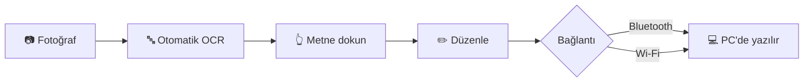

# Okut-Yaz

**Fotoğrafı okut, bilgisayara yazsın.**

Fatura, fiş ve belge fotoğraflarındaki metni telefonda okur, bilgisayarda imlecin olduğu yere **klavye gibi yazar**.

[**İndir**](../../releases) · [Nasıl çalışır](#-nasıl-çalışır) · [Kullanım](#-kullanım) · [Derleme](#-derleme)

---

## ✨ Özellikler

| | |
|---|---|
| 📷 **Kamera veya galeri** | Fotoğraf çek ya da galeriden seç. Çekilen fotoğraf galeriye kaydedilmez. |
| 👆 **Dokun ve seç** | Fotoğraf çekilince tüm metinler otomatik taranır. Göndermek istediğin satıra ya da kelimeye dokunman yeter; birden fazla dokunarak birleştirebilirsin. |
| ✂️ **Alan çizme (yedek)** | Otomatik tarama istediğini bulamazsa çerçeveyi sürükleyip boyutlandırarak alan seçebilirsin. |
| 🔤 **Cihaz üzerinde OCR** | Google ML Kit ile metin telefonda okunur. Fotoğraflar hiçbir sunucuya gönderilmez. |
| ✏️ **Göndermeden düzenle** | Okunan metni kontrol et, gerekirse düzelt. |
| ⌨️ **Bluetooth klavye** | Telefon, eşleşmiş bilgisayara klavye gibi görünür. PC'ye program kurmak gerekmez. Türkçe Q, Türkçe F ve US klavye düzenleri desteklenir (ç ğ ı ö ş ü @ # $ dahil). |
| 🌐 **Tarayıcı ile gönderim** | PC'ye hiçbir şey kurmadan: PC tarayıcısında açılan sayfadan kopyala, yapıştır. |
| 📶 **Wi-Fi ile gönderim** | Bluetooth'u olmayan bilgisayarlar için küçük bir Windows alıcı programı. Türkçe karakterleri de doğru yazar. |
| ⬇️ **Excel'de alt hücreye geç** | Gönderdikten sonra Enter (alt hücre) veya Tab (sağ hücre) basar. Art arda hücre doldurmak için ideal. |
| 🗂 **Sonra gönder (bekleyenler)** | Bağlantı yokken bile seçtiğin metinleri kaydet. Bağlantı kurulunca uygulama onayını alıp hepsini sırayla gönderir. |
| 🕘 **Gönderim geçmişi** | Son 200 gönderimi listele, tekrar kullan, kopyala veya sil. |
| 🌙 **Koyu mod** | Sistem temasını izler ya da elle seçilir. |

## 🔄 Nasıl çalışır

## 📲 Kurulum

1. [**Releases**](../../releases) sayfasından en son `.apk` dosyasını indir.
2. Telefonda dosyayı aç. Android "bilinmeyen kaynaklardan yükleme" izni isteyebilir.
3. Uygulamayı aç, Bluetooth ve kamera izinlerini ver.

> **Gereksinim:** Android 9 (API 28) veya üzeri.

## 🚀 Kullanım

### Bluetooth ile
1. Windows → **Ayarlar → Bluetooth ve cihazlar** bölümünden telefonu eşleştir.
2. Uygulamada **PC'ye bağlan** ile bilgisayarı seç.
3. Fotoğraf çek. Metinler otomatik taranır; göndermek istediğin satıra ya da kelimeye dokun. Seçilen metin aşağıdaki kutuya yazılır.
4. Bilgisayarda yazılacak alanı (örn. Excel hücresi) tıkla ve **Metni gönder**'e bas.

### Wi-Fi ile (Bluetooth'u olmayan PC)
1. PC'de `PC-Alici/OkutYaz-PC-Baslat.bat` dosyasını çalıştır. Ekranda **IP adresi** ve **4 haneli kod** görünür.
2. Telefonda **⚙ Ayarlar → Bağlantı yöntemi: Wi-Fi** seç, IP ve kodu girip **Kaydet ve bağlantıyı dene**'ye bas.
3. Telefon ve PC **aynı Wi-Fi ağında** olmalı. Windows güvenlik duvarı sorarsa "Özel ağlar"a izin ver.

### Tarayıcı ile (PC'ye hiçbir şey kurmadan)
1. Telefonda **⚙ Ayarlar → Bağlantı yöntemi: Tarayıcı** seç. Ayarlarda bir **adres** ve **kod** görünür.
2. PC'de herhangi bir tarayıcı aç, adresi yaz (örn. `http://192.168.1.20:8766`) ve kodu gir.
3. Telefondan **Metni gönder**'e basınca metin sayfada görünür. **Kopyala**'ya bas, hedef alanda **Ctrl+V** ile yapıştır.

> Bu yöntem metni otomatik yazmaz (tarayıcılar başka programlara tuş basamaz), Excel'de alt hücreye de geçmez. Otomatik yazım için Bluetooth veya Wi-Fi (alıcı program) yöntemini kullan.

### Bağlantı yokken kaydet, sonra gönder
1. Metni seç ya da kutuya yaz, **➕ Sonra gönder**'e bas. Metin **Bekleyenler** listesine eklenir ve kutu temizlenir.
2. Bağlantı olmadan **Metni gönder**'e basarsan uygulama "Sıraya eklensin mi?" diye sorar.
3. PC'ye bağlanınca uygulama "N kayıt bekliyor, şimdi gönderilsin mi?" diye onay ister. **Bekleyenler → Hepsini gönder** ile elle de başlatabilirsin.
4. Kayıtlar eklenme sırasıyla gönderilir. Gönderilenler listeden silinir ve geçmişe yazılır. Bir hata olursa gönderim durur, kalanlar listede kalır.

### Excel'de art arda doldurma
**⚙ Ayarlar → Gönderdikten sonra → ↓ Alt hücre** seçili olsun. Her gönderimden sonra imleç bir alt hücreye geçer.

## 🔒 Güvenlik

- Wi-Fi yönteminin PC alıcısı (`PC-Alici/OkutYaz-PC.ps1`) düz metin bir PowerShell betiğidir. Çalıştırmadan önce Not Defteri ile açıp okuyabilirsin. Yönetici izni istemez, yalnızca yerel ağda belirlenen portu dinler ve doğru kod gelmeden hiçbir şey yazmaz.
- Çalıştırmak istemeyenler için **Bluetooth** (PC'de program gerekmez) veya **Tarayıcı** (PC'de program gerekmez) yöntemleri var.
- Kod ve metinler yerel ağda şifrelenmeden gider; yalnızca güvendiğin ağlarda kullan.

## ⚠️ Bilinen sınırlamalar

- Android'in Bluetooth HID Device desteği telefon modeline bağlıdır; bazı telefonlarda yoktur. Bu durumda Wi-Fi yöntemini kullan.
- Bluetooth modunda yazılan karakterler bilgisayarın klavye düzenine göre yorumlanır. Ayarlar'dan bilgisayarının düzenini (Türkçe Q, Türkçe F veya US) seç. Wi-Fi modunda bu ayar gerekmez.
- Gönderim sırasında uygulamayı ön planda tut.
- Wi-Fi modunda kod ve metin şifrelenmeden yerel ağ üzerinden gider. Yalnızca güvendiğin ağlarda kullan.

## 🧰 Teknoloji

Kotlin · Google ML Kit Text Recognition (Latin) · Android `BluetoothHidDevice` API · Windows tarafında PowerShell

## 📄 Lisans

[MIT](LICENSE)
